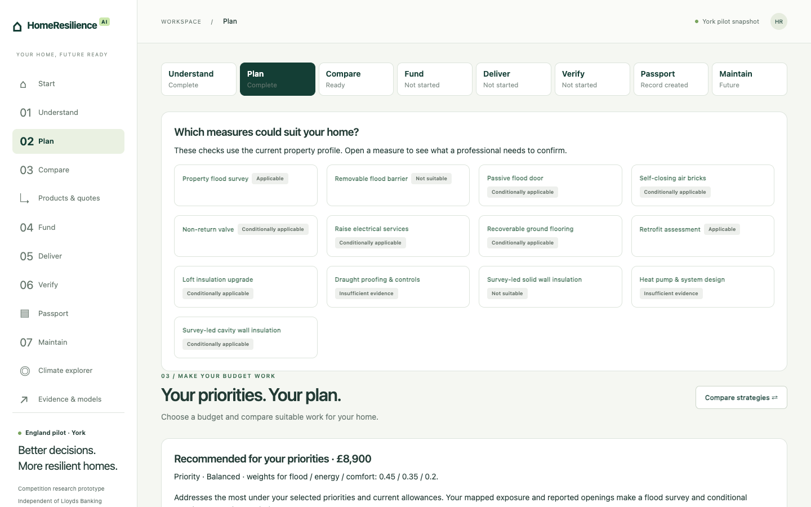

# HomeResilience AI

Decision support for households planning, funding and tracking flood resilience and energy improvements.

**Live demo:** [HomeResilience AI demo website](https://liuxinyi15.github.io/HomeResilience-AI/). 

[Run the same demo locally](#run-locally).



## The problem

Homeowners have to piece together flood maps, property details, retrofit advice, quotes and funding rules. It is hard to compare what fits a budget, see which assumptions drove the decision, and carry the record forward after work is done.

## Our solution

HomeResilience AI connects assessment, planning, comparison, funding, delivery and verification in one journey. It screens improvements for suitability, compares feasible packages under **Balanced**, **Flood first** and **Energy first** priorities, and records decisions and completed work in a **Home Resilience Passport**. The York pilot is a competition prototype independent of Lloyds Banking Group.

## Try the demo

1. Choose **Open Emma’s demo** on Start for a fictional York household, or **Open my home** to enter your own inputs. Enable browser saving on Start to keep your workspace across reloads.
2. In **Understand**, review the Problem Map and property information. For My Home, select an assessment area and complete the required fields.
3. In **Plan**, try **£2,000** and **£10,000** and switch priorities. In **Compare**, review the trade-offs or edit a plan in the Comparison Lab. Confirm one option to unlock funding.
4. In **Products & quotes**, load the fictional Emma quotes and compare price, scope and configuration. In **Fund**, try staged work and an illustrative repayment scenario.
5. In **Deliver** and **Verify**, record a stage and its evidence. Inspect and export the **Passport**. Change the budget or property assumptions to see earlier decisions become outdated while completed work stays in the record.

Emma’s scenario starts with a fictional gas-heated semi in York at a £10,000 budget. The [guided walkthrough](docs/demo-walkthrough.md) has the expected outputs and a worked Passport example.

[Assessment](screenshots/01-assessment.png) · [Comparison](screenshots/03-comparison.png) · [Funding](screenshots/04-funding.png) · [Passport](screenshots/05-passport.png)

## How it works

The existing Python engine screens measures, enumerates feasible combinations and ranks portfolios by declared preferences. It uses Environment Agency York area data and published NEED insulation group effects. The retrospective gas consumption model provides optional context; it does not rank plans. EPC validation is included as aggregate evidence of agreement and coverage, with its limitations.

The competition demo runs the Python engine in a browser worker using Pyodide and WebAssembly. HTML, CSS, JavaScript, and the required data are served as static files. There is no application server, account, or API key. Property inputs are processed in the browser, and Passport saving is opt-in and local to the browser and site origin.

- [Architecture and deployment](docs/architecture.md)
- [Assessment, recommendation and funding methodology](docs/methodology.md)
- [Data sources, evidence and third-party terms](docs/data-and-evidence.md)

## Responsible use

This is decision support. The York flood pilot covers river and sea area evidence; it does not assess surface water, groundwater or property-level damage probability. Missing coverage does not establish safety. Group energy effects are uncertain and cannot predict a specific home’s savings. A qualified professional should verify suitability, design and installation. Costs, funding and repayment examples are illustrative; the demo cannot determine eligibility or issue a quote or finance offer.

## Run locally

From the repository root, run this and open [http://127.0.0.1:8000/](http://127.0.0.1:8000/):

```sh
python3 -m http.server 8000 --bind 127.0.0.1 --directory site
```

Use a modern browser with WebAssembly, Web Workers and gzip streams. Python serves files only; no packages, credentials or external requests are required to use the demo. The first load downloads the bundled calculation runtime and York data. Opening `site/index.html` as a file bypasses HTTP and will not work.


## Repository structure

| Path | Purpose |
| --- | --- |
| `site/` | Static app, Python engine source, browser runtime, assets, evidence and demo data |
| `docs/` | Walkthrough, architecture, methodology and source notes |
| `screenshots/` | Screens captured from the public release build |
| `tests/` | Journey, recommendation and GitHub Pages browser checks |
| `tools/check-release.py` | Checks the published snapshot and pinned runtime hashes |
| `.github/workflows/deploy.yml` | GitHub Pages deployment |

## Team

Team details to be added by the project team.

## Competition

TCS Sustainathon UKI 2026 · Competition demo and portfolio release.
