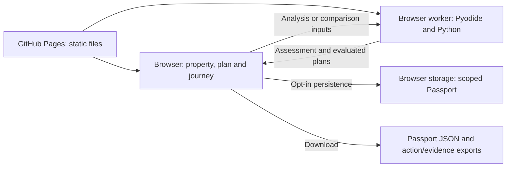

# Architecture

The competition demo is a static site. The original local build served files and ran two Python calculation endpoints. This release keeps the frontend, calculation code and required snapshot data and changes how the browser calls the calculation engine.



- `site/app.js` manages the assessment, map, planner and hash routes. `comparison.js` and `decision-intelligence.js` render recommendations and manage custom plans.
- `browser-api.js` loads static evidence and map display data and sends calculations to `engine-worker.mjs`. The worker loads the pinned Pyodide runtime and mounts files for `src/homeresilience/` in memory. `engine.py` evaluates the property and enumerates plans; `comparison.py` checks custom portfolios and evaluates changes in cost, scope and evidence. They use the standard-library geometry path; no spatial package or inference server is needed.
- The site uses relative URLs, including worker imports and evidence downloads. The default layers required by the assessment are loaded on the first analysis; additional map scenarios load as selected. Gzip packaging reduces transfer size without changing any full-resolution analysis file.
- `journey.js` and `journey-state.js` scope decisions to each home. Saved state is tied to this origin and browser. There is no account sync. Passport JSON is an export, with no import flow. Verification records a user’s document review; uploaded document contents are neither read nor sent to a server. Export excludes raw gas histories, coordinates, internal context keys and private document text and file names. Local browser state can still contain information that the user enters.
- Property and finance inputs go to the local worker. The demo makes no external requests to compute results. Source links, if opened, go to their publishers. Use fictional inputs for a public walkthrough.

The prototype has no live postcode or EPC lookup, quotation, lending, document verification, or reminder service. A production system with these features would need its own source permissions, data protection, professional validation, and service integrations.

## Reproduce the release checks

```sh
python3 tools/check-release.py
node --test tests/journey-state.test.cjs
npm install --no-save --no-package-lock playwright
npx playwright install chromium
node tests/journey-browser.cjs
node tests/decision-browser.cjs
node tests/pages-browser.cjs
```

The browser tests serve only static files at `/HomeResilience-AI/`. They cover the Emma and My Home journeys, plan/cost calculations and exports, and Pages assets, data, navigation, reload and layouts at 390, 768 and 1440 px. The browser runner requires Node.js and Playwright only for verification. It does not rebuild the site.
